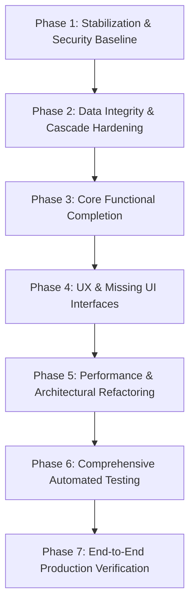

# Implementation Roadmap & Modernization Plan: AlumniBridge

**Audit Date:** November 2026  
**Auditor:** Senior Product Architect, Technical Lead & QA Engineer  
**Execution Note:** Do not start implementing anything until explicit user approval is granted.

---

## 1. Roadmap Phasing Strategy

---

## 2. Phase 1: Stabilization & Security Baseline

### Task 1.1: Enable Spring Security & Implement BCrypt Password Hashing
- **Priority:** CRITICAL
- **Complexity:** Medium (3-4 story points)
- **Files Affected:**
  - `Alumni-Bridge/pom.xml`
  - `Alumni-Bridge/src/main/java/com/yaswanth/Alumni_Bridge/config/SecurityConfig.java` (New)
  - `UserService.java`
  - `AuthController.java`
- **Dependencies:** None.
- **Expected Outcome:** Passwords securely hashed with BCrypt. Spring Security filter chain active.
- **Acceptance Criteria:**
  - `spring-boot-starter-security` uncommented and compiled.
  - Passwords in `users` table are prefixed with BCrypt hash format (`$2a$12$...`).
  - Plaintext password comparison removed.
  - Public routes (`/`, `/login`, `/register`, `/css/**`, `/js/**`) accessible without auth; protected routes require authenticated session.

### Task 1.2: Enforce Privilege Protection on Registration
- **Priority:** CRITICAL
- **Complexity:** Low (1 story point)
- **Files Affected:**
  - `AuthController.java`
  - `User.java` / `RegisterRequestDto.java` (New)
- **Dependencies:** Task 1.1.
- **Expected Outcome:** Prevent public registration from assigning the `ADMIN` role.
- **Acceptance Criteria:**
  - Registration endpoint strictly accepts `STUDENT` or `ALUMNI`.
  - Submitting `role=ADMIN` defaults to `STUDENT` or throws validation error.

### Task 1.3: Enforce Blocked User Restriction
- **Priority:** CRITICAL
- **Complexity:** Low (1 story point)
- **Files Affected:**
  - `UserService.java`
  - `AuthController.java`
  - `SecurityConfig.java`
- **Dependencies:** Task 1.1.
- **Expected Outcome:** Blocked users cannot log in; existing sessions for newly blocked accounts are terminated.
- **Acceptance Criteria:**
  - Attempting login with a blocked account displays an error: "Account deactivated. Contact administrator."
  - Blocked users cannot access protected endpoints.

### Task 1.4: Mitigate Arbitrary File Upload & Path Traversal in Avatar Upload
- **Priority:** CRITICAL
- **Complexity:** Medium (2 story points)
- **Files Affected:**
  - `ProfileController.java`
  - `application.properties`
- **Dependencies:** None.
- **Expected Outcome:** Avatars restricted strictly to JPEG, PNG, and WebP formats; safe random filenames generated.
- **Acceptance Criteria:**
  - Uploading `.html`, `.jsp`, `.exe`, or non-image files is rejected with a 400 Bad Request.
  - Filenames are randomized UUIDs (`UUID.randomUUID().toString() + ".jpg"`).
  - Directory traversal sequences (`../`) rejected.
  - Maximum upload size restricted to 2MB.

---

## 3. Phase 2: Data Integrity & Cascade Hardening

### Task 2.1: Add Database Unique & Integrity Constraints
- **Priority:** CRITICAL
- **Complexity:** Medium (2 story points)
- **Files Affected:**
  - `User.java`
  - `Application.java`
  - `EventRegistration.java`
- **Dependencies:** None.
- **Expected Outcome:** Prevent duplicate emails and duplicate registrations/applications at the database schema level.
- **Acceptance Criteria:**
  - Unique constraint added on `User.email`.
  - Composite unique constraint added on `Application(user_id, job_id)`.
  - Composite unique constraint added on `EventRegistration(user_id, event_id)`.
  - Service methods catch duplicate exceptions and return graceful validation feedback.

### Task 2.2: Implement Safe Cascade Deletion Logic in Service Layer
- **Priority:** CRITICAL
- **Complexity:** High (5 story points)
- **Files Affected:**
  - `UserService.java`
  - `JobService.java`
  - `EventService.java`
  - `AdminController.java`
- **Dependencies:** Task 2.1.
- **Expected Outcome:** Deleting a user, job, or event no longer crashes with SQL foreign key constraint violations.
- **Acceptance Criteria:**
  - Deleting a job cleanly cascades and removes associated applications.
  - Deleting an event cleanly cascades and removes registrations.
  - Deleting a user disassociates or removes profile, applications, and registrations without throwing `DataIntegrityViolationException`.
  - Admin cannot delete their own account.

### Task 2.3: Convert State-Mutating GET Routes to POST with CSRF Protection
- **Priority:** HIGH
- **Complexity:** Medium (3 story points)
- **Files Affected:**
  - `AdminController.java`, `admin-users.html`, `admin-jobs.html`, `admin-events.html`
  - `JobController.java`, `jobs.html`
  - `EventController.java`, `events.html`
- **Dependencies:** Task 1.1.
- **Expected Outcome:** Eliminate CSRF vulnerabilities and conform to HTTP standards.
- **Acceptance Criteria:**
  - Deletions, block toggle, job applications, and event registrations operate via POST forms with CSRF tokens.
  - Confirmation modals ("Are you sure you want to delete?") added to administrative UI.

---

## 4. Phase 3: Core Functional Completion

### Task 3.1: Build Recruiter / Job Poster Applicant Review Portal
- **Priority:** CRITICAL
- **Complexity:** High (5 story points)
- **Files Affected:**
  - `JobController.java`
  - `JobService.java`
  - `ApplicationService.java`
  - `ApplicationRepository.java`
  - `job-applicants.html` (New Template)
- **Dependencies:** Phase 2.
- **Expected Outcome:** Alumni who post jobs can view applicants and review candidate profiles.
- **Acceptance Criteria:**
  - New route `GET /jobs/{id}/applicants` accessible by job poster and admin.
  - Displays applicant name, email, profile link, application date, and status.
  - Ability to update application status (`IN_REVIEW`, `SHORTLISTED`, `REJECTED`, `HIRED`).

### Task 3.2: Implement Job Details View (`/jobs/{id}`)
- **Priority:** HIGH
- **Complexity:** Low (2 story points)
- **Files Affected:**
  - `JobController.java`
  - `job-details.html` (New Template)
  - `jobs.html`
- **Dependencies:** None.
- **Expected Outcome:** Users can read full job descriptions before applying.
- **Acceptance Criteria:**
  - Route `GET /jobs/{id}` renders job title, company, location, full text description, poster details, and Apply button.
  - Link from `jobs.html` cards directs to `/jobs/{id}`.

### Task 3.3: Implement Event Attendee Management for Organizers
- **Priority:** HIGH
- **Complexity:** Medium (3 story points)
- **Files Affected:**
  - `EventController.java`
  - `EventService.java`
  - `event-attendees.html` (New Template)
- **Dependencies:** Phase 2.
- **Expected Outcome:** Event creators and admins can view registered attendees.
- **Acceptance Criteria:**
  - Route `GET /events/{id}/attendees` lists all registered users.
  - Displays attendee name, email, registration date, and direct message link.

### Task 3.4: Group Direct Messages by Conversation in Inbox
- **Priority:** HIGH
- **Complexity:** Medium (4 story points)
- **Files Affected:**
  - `MessageRepository.java`
  - `MessageService.java`
  - `MessageController.java`
  - `messages.html`
- **Dependencies:** None.
- **Expected Outcome:** Inbox displays unique conversation threads instead of repeated raw messages.
- **Acceptance Criteria:**
  - Inbox groups messages by conversation partner.
  - Displays partner name, avatar, snippet of latest message, timestamp, and unread count badge.

---

## 5. Phase 4: UX & Missing UI Interfaces

### Task 4.1: Expand Profile Fields (Education & Social Links)
- **Priority:** HIGH
- **Complexity:** Medium (3 story points)
- **Files Affected:**
  - `Profile.java`
  - `profile.html`
  - `edit-profile.html`
  - `view-user.html`
- **Dependencies:** Phase 2.
- **Expected Outcome:** Profiles support Degree, Department, Graduation Year, Roll Number, LinkedIn, GitHub, and Phone.
- **Acceptance Criteria:**
  - Form inputs added in `edit-profile.html`.
  - Display sections added in `profile.html` and `view-user.html`.

### Task 4.2: Add Admin Application Oversight & Real Dashboard Analytics
- **Priority:** HIGH
- **Complexity:** Medium (3 story points)
- **Files Affected:**
  - `AdminController.java`
  - `admin-dashboard.html`
  - `admin-applications.html` (New Template)
- **Dependencies:** Phase 3.
- **Expected Outcome:** Admin dashboard displays active user counts, job counts, application metrics, and full application oversight table.
- **Acceptance Criteria:**
  - Admin dashboard displays live metrics from database `count()` queries.
  - Admin can view all platform applications at `/admin/applications` with filter by status.

### Task 4.3: Clean Up UI Bugs & Typos
- **Priority:** LOW
- **Complexity:** Low (1 story point)
- **Files Affected:**
  - `dashboard.html`
  - `alumni-list.html`
- **Dependencies:** None.
- **Expected Outcome:** Remove stray `</html>F` from `dashboard.html`; retain search values in directory form.

---

## 6. Phase 5: Performance & Architectural Refactoring

### Task 6.1: Eliminate View-Layer N+1 Queries
- **Priority:** HIGH
- **Complexity:** Medium (2 story points)
- **Files Affected:**
  - `JobController.java`, `jobs.html`
  - `EventController.java`, `events.html`
- **Dependencies:** Phase 3.
- **Expected Outcome:** Zero service calls from Thymeleaf templates; single-query preloading.
- **Acceptance Criteria:**
  - Remove `@applicationService` and `eventService` injection into view models.
  - Preload user's applied job IDs and registered event IDs in the controller as `Set<Long>`.
  - Database roundtrips reduced from 51+ to 2 per page view.

### Task 6.2: Add Database Pagination for Directory, Jobs, and Events
- **Priority:** MEDIUM
- **Complexity:** Medium (3 story points)
- **Files Affected:**
  - `UserRepository.java`, `AlumniController.java`, `alumni-list.html`
  - `JobRepository.java`, `JobController.java`, `jobs.html`
  - `EventRepository.java`, `EventController.java`, `events.html`
- **Dependencies:** None.
- **Expected Outcome:** Fast, scalable data loading using Spring Data `Pageable`.
- **Acceptance Criteria:**
  - Default page size of 12 items.
  - Bootstrap pagination controls (`Previous`, `Page Numbers`, `Next`) rendered on templates.

### Task 6.3: Clean Up Stereotype Annotations on Repositories
- **Priority:** LOW
- **Complexity:** Low (1 story point)
- **Files Affected:**
  - `EventRepository.java`
  - `EventRegistrationRepository.java`
- **Dependencies:** None.
- **Expected Outcome:** Remove `@Service` annotation from JPA repository interfaces.

---

## 7. Phase 6: Automated Testing & QA Suite

### Task 7.1: Configure Test Dependencies & Test Infrastructure
- **Priority:** CRITICAL
- **Complexity:** Medium (2 story points)
- **Files Affected:**
  - `pom.xml`
  - `src/test/resources/application-test.properties` (New)
- **Dependencies:** Task 1.1.
- **Expected Outcome:** Uncomment `spring-boot-starter-test` and configure in-memory H2 database for testing.
- **Acceptance Criteria:**
  - `./mvnw test` executes cleanly without requiring external MySQL instance.

### Task 7.2: Unit Tests for Services (Mockito)
- **Priority:** HIGH
- **Complexity:** High (5 story points)
- **Files Affected:**
  - `src/test/java/.../service/UserServiceTest.java` (New)
  - `src/test/java/.../service/JobServiceTest.java` (New)
  - `src/test/java/.../service/ApplicationServiceTest.java` (New)
  - `src/test/java/.../service/EventServiceTest.java` (New)
- **Expected Outcome:** Comprehensive unit test coverage for all core business logic.
- **Acceptance Criteria:**
  - Minimum 80% code coverage on service layer.
  - Tests covering password encoding, duplicate email rejection, blocked account login rejection, self-application prevention.

### Task 7.3: Integration & Web MVC Security Tests (MockMvc)
- **Priority:** HIGH
- **Complexity:** High (5 story points)
- **Files Affected:**
  - `src/test/java/.../controller/AuthControllerTest.java` (New)
  - `src/test/java/.../controller/AdminControllerSecurityTest.java` (New)
  - `src/test/java/.../controller/JobControllerTest.java` (New)
- **Expected Outcome:** Verified role-based authorization rules and CSRF protection.
- **Acceptance Criteria:**
  - Verifies unauthorized users cannot access `/admin/**`.
  - Verifies students cannot create events or post jobs.
  - Verifies CSRF token requirement on all POST requests.

---

## 8. Phase 7: End-to-End Production Verification

### Task 7.1: Manual End-to-End Verification
- **Priority:** HIGH
- **Complexity:** Medium (2 story points)
- **Scope:** Verify complete user journeys for Student, Alumni, and Admin roles.
- **Checklist:**
  - Registration -> Email verification -> Login -> Profile update with avatar.
  - Student searches Alumni -> Initiates chat -> Sends message -> Alumni receives in inbox.
  - Alumni posts job -> Student applies -> Alumni views candidate in `/jobs/{id}/applicants` -> Updates status.
  - Alumni creates event -> Student registers -> Organizer views attendee list.
  - Admin moderates user (block/unblock) -> Verifies blocked user is prevented from logging in.
  - Admin deletes user/job/event -> Verifies clean cascade without database errors.

---

## 9. Implementation Sequence Summary

| Order | Phase | Focus Area | Key Deliverables |
|---|---|---|---|
| **1** | Phase 1 | Stabilization & Security Baseline | BCrypt hashing, Spring Security, file upload security, role escalation fix. |
| **2** | Phase 2 | Data Integrity & Cascade Hardening | Unique constraints, safe cascade deletion logic, convert GET mutations to POST. |
| **3** | Phase 3 | Core Functional Completion | Recruiter applicant review, job details view, event attendees, grouped inbox. |
| **4** | Phase 4 | UX & Missing Interfaces | Education profile fields, admin analytics, typo fixes. |
| **5** | Phase 5 | Performance & Refactoring | Fix N+1 queries, add pagination, clean repository annotations. |
| **6** | Phase 6 | Automated Testing Suite | Unit tests with Mockito, MockMvc integration security tests, H2 test profile. |
| **7** | Phase 7 | End-to-End Verification | Production smoke testing, user journey sign-offs. |
